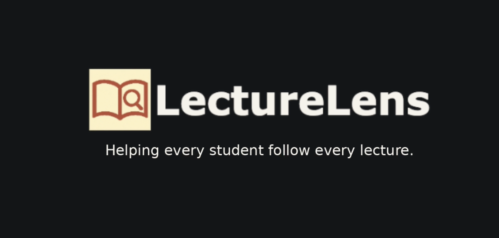
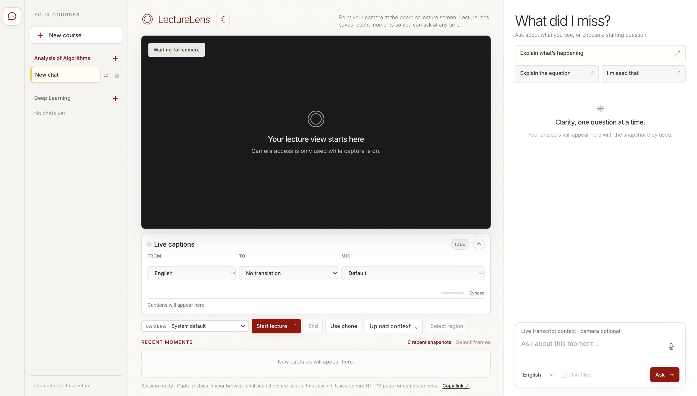

# LectureLens

  

  <strong>An accessible, multimodal AI companion that connects what a professor says with what they show.</strong>

  <a href="https://canva.link/pteibr2lp44r19v"><strong>View the presentation</strong></a>
  &nbsp;·&nbsp;
  <a href="https://youtu.be/mw0Exo8Qb4E"><strong>Watch the demo</strong></a>

## Product

## Inspiration

Every student learns and processes information differently. LectureLens helps visually impaired students, hard-of-hearing students, multilingual learners, and anyone who needs more time or context to follow a lecture.

Students should be able to consume lectures in the format that works best for them: through captions, translations, audio, visual descriptions, zoomed-in images, or the ability to pause and revisit moments. By connecting what the professor says with what they show, LectureLens makes lectures more accessible and easier to understand.

## What it does

LectureLens is an AI companion for visually impaired and hard-of-hearing students and for students navigating unfamiliar accents or language barriers. With multilingual support, it works in real time by combining live captions, translations, board images, slides, course materials, and student questions on one synchronized timeline.

Students can:

- Revisit the exact moment they missed
- View the associated board or slide image
- Ask private questions by voice or text
- Receive answers grounded in the lecture
- Select image regions or compare multiple frames
- Listen to answers aloud
- Generate a structured lecture recap

Unlike a general chatbot, LectureLens already has the lecture context. Students do not need to reconstruct the class using scattered screenshots or notes.

## How we built it

Every caption, image, uploaded material, and question receives a timestamp tied to a shared lecture clock. This allows LectureLens to retrieve the most relevant context for each question.

The frontend uses HTML, CSS, and JavaScript. The backend uses Python, FastAPI, and SQLite. Speech recognition uses the browser's Web Speech API with an in-browser Whisper fallback.

OpenAI's multimodal model combines transcript segments, visuals, course materials, and recent conversation to generate grounded answers with evidence timestamps. OpenAI's speech API provides optional natural read-aloud output.

Students can capture the board with a laptop camera or scan a QR code to upload clearer images from a phone.

## Challenges we ran into

Our biggest challenge was synchronizing audio, visuals, phone uploads, slides, and questions from different sources. A shared session ID and lecture clock helped us connect these events reliably.

Browser speech recognition can stop after silence or depend on an internet connection, so we added automatic restarts, duplicate prevention, retry handling, and a Whisper fallback.

We also had to handle uncertainty. A nearby image may not always be the exact visual a professor referenced, so LectureLens treats it as supporting context rather than guaranteed proof.

## Accomplishments that we're proud of

Our prototype can:

- Connect speech and visuals on a shared timeline
- Support captions and answers in ten languages
- Use transcripts, images, and course materials together
- Accept phone-camera uploads during a live lecture
- Answer questions about selected image regions
- Compare multiple lecture frames
- Provide evidence-backed answers
- Generate structured study recaps

Most importantly, LectureLens is designed around different ways of accessing information instead of assuming every student learns the same way.

## What we learned

We learned that a strong AI model is only part of the solution. Accurate timing, organized context, accessible interaction, and clear evidence are just as important.

A shared timeline makes it possible to connect what was said with what was shown. We also learned to design around uncertainty and give students the original sources so they can evaluate an answer themselves.

## What's next for LectureLens

We want to make LectureLens even more immersive and accessible by exploring features such as:

- Meta-style smart glasses that provide real-time captions, translations, and descriptions of what is on the board
- Audio guidance that identifies where the professor is pointing
- Personalized lecture views based on each student's preferred language and format
- Wearable or spatial notifications when important visual information appears
- Real-time collaboration between phones, laptops, and classroom displays

Our goal is to make lectures easier to follow in real time, whether students are reading captions, listening to descriptions, viewing visuals, or using assistive technology.

## Technical overview

LectureLens captures microphone audio and board images on one shared session clock. It creates live captions with optional translation, stores final transcript segments in SQLite, captures laptop-camera snapshots, and accepts phone photos plus PDF/image slide uploads. The interface organizes chats by course; accepts PPT, PDF, Word, image, and text files as optional context; lets students compare up to four frames, zoom into a snapshot, select a region, and ask follow-up questions in ten languages. OpenAI receives chosen visuals, nearby timestamped transcript, selected file content, and recent conversation; answers retain their evidence timestamps.
